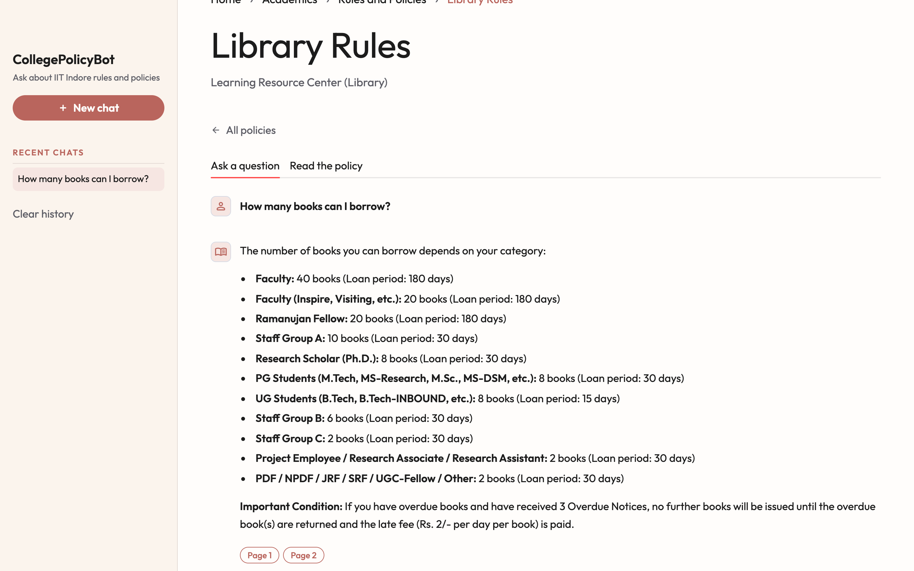
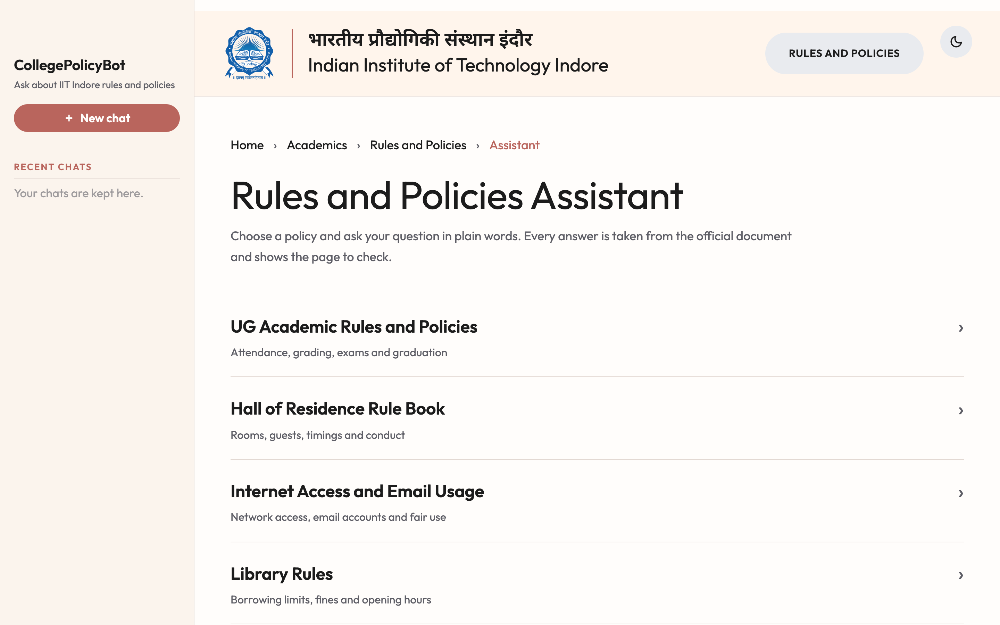
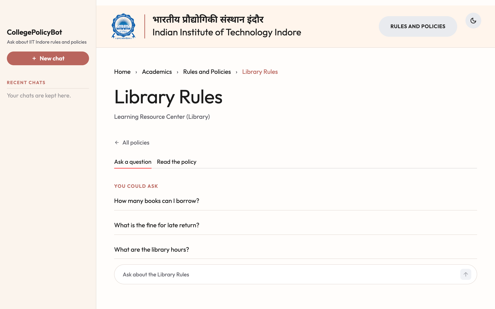
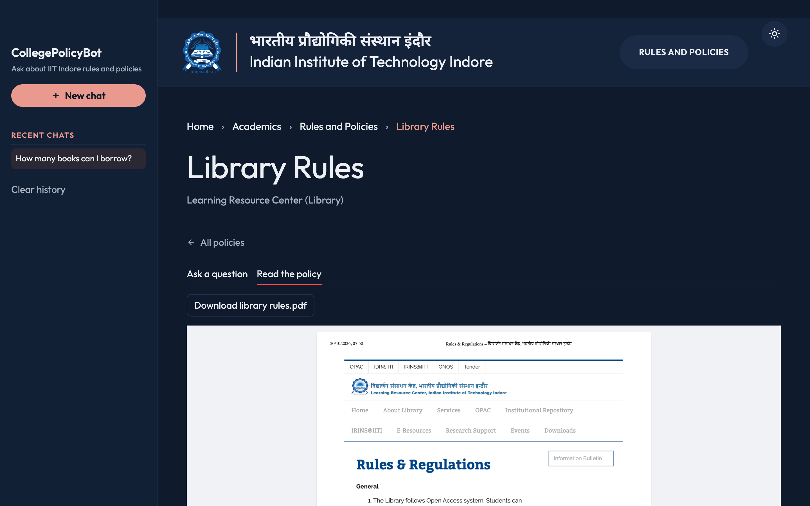
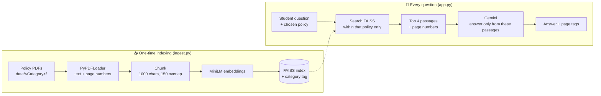

<div align="center">

# 🎓 CollegePolicyBot

### Ask IIT Indore's rule books a question, get an answer with the page to check

An AI assistant that answers questions about IIT Indore's official rules and policies (academics, hostel, mess, library, internet and placements) using only the official PDF documents, and shows the page each answer came from.




</div>

---

## 📌 Why this exists: the IIT Indore use case

Every student at IIT Indore is bound by a stack of rule books. The UG Academic Rules alone run to dozens of pages, and the Hall of Residence, Mess, Library, Internet and Placement policies each add more. Students need answers to questions like these:

- *"What is the minimum attendance I need, and what happens if I fall short?"*
- *"Can I reject a placement offer, and what is the penalty?"*
- *"How many books can a B.Tech student borrow, and for how long?"*
- *"How do I apply for a mess rebate?"*

Today, getting those answers means digging through long PDFs, asking seniors (whose answers may be out of date), or waiting for a reply from the relevant office.

**CollegePolicyBot** gives students one place to ask in plain words:

| Who | How it helps |
|---|---|
| 🧑‍🎓 **Students** (UG, PG, PhD) | Instant answers about attendance, grading, hostel, mess, library and placement rules, at any hour |
| 🆕 **Freshers** | A friendly first stop for "how does this work here?" questions during orientation |
| 💼 **Placement aspirants** | Clear answers on CAMC eligibility, resume rules and offer policies before decisions that matter |
| 🏛️ **Institute offices** | Fewer repeated queries to the Academic Office, Hall Office, Library and CAMC |

Every answer is **grounded in the official document** and shows the **page number**, so students can check it in seconds instead of trusting an unsourced reply.

---

## ✨ Features

- **📚 Six official IIT Indore policies, ready to use:** UG Academic Rules, Hall of Residence Rule Book, Mess Rules, Library Rules, Internet & Email Usage Policy, and Placement Policy 2026-27.
- **🎯 Answers from the chosen policy:** a Mess question is answered from the Mess rules, never from the Placement policy.
- **🔖 Page references on every answer:** each answer shows tags such as `Page 1` and `Page 2`; hover over a tag to see the source PDF.
- **🚫 No invented rules:** the model must answer only from the retrieved policy text, and to say so when the answer isn't there.
- **📖 Read the policy in the app:** view or download the original PDF next to the chat.
- **💬 Private chat history:** each visitor's past conversations stay in their own sidebar, like a messaging app.
- **💡 Suggested questions:** each policy offers starter questions so students know what to ask.
- **🌗 Light and dark mode:** a design based on the official [iiti.ac.in](https://www.iiti.ac.in) website, with the institute's bilingual header.
- **🔁 Fallback when quota runs out:** if the main Gemini model hits its quota, the app moves to the next model, so free-tier keys keep working.
- **➕ Easy to extend:** add a new folder of PDFs to `data/`, rebuild the index, and a new policy category appears automatically.

---

## 🖼️ Screenshots

<table>
  <tr>
    <td width="50%"><p align="center"><b>Home: choose a policy</b></p></td>
    <td width="50%"><p align="center"><b>Suggested questions for each policy</b></p></td>
  </tr>
  <tr>
    <td width="50%"><p align="center"><b>Answer from the source, with page tags</b></p></td>
    <td width="50%"><p align="center"><b>Read the official PDF (dark mode)</b></p></td>
  </tr>
</table>

---

## 🧠 How it works

CollegePolicyBot uses **Retrieval-Augmented Generation (RAG)**. Instead of relying on what a language model happens to remember, it first finds the relevant passages in the official PDFs, then asks the model to answer **only from those passages**.



1. **Indexing:** `ingest.py` reads every PDF in `data/<Category>/`, splits the text into overlapping chunks, tags each chunk with its category, source file and page, and stores the embeddings in a local FAISS index.
2. **Retrieval:** when a student asks a question, the app searches only the chunks of the chosen policy and keeps the 4 most relevant.
3. **Generation:** Gemini receives those passages with strict instructions: answer clearly, use bullet points for lists, include conditions and exceptions, never invent rules, and say so when the answer isn't in the text.
4. **Citation:** the answer is shown with the page numbers it was built from.

---

## 🛠️ Tech stack

| Layer | Technology |
|---|---|
| Interface | [Streamlit](https://streamlit.io) with custom CSS based on iiti.ac.in |
| Orchestration | [LangChain](https://www.langchain.com) |
| PDF parsing | `PyPDFLoader` (pypdf) |
| Chunking | `RecursiveCharacterTextSplitter` |
| Embeddings | Hugging Face `sentence-transformers/all-MiniLM-L6-v2` (runs locally, free) |
| Vector store | [FAISS](https://github.com/facebookresearch/faiss) (local, no database server) |
| LLM | Google Gemini (`gemini-3.8-flash`, falling back to `gemini-3.5-flash` and lite models when out of quota) |

---

## 🚀 Getting started

### 1. Prerequisites

- Python **3.10 or 3.11**
- A free Google Gemini API key from **[Google AI Studio](https://aistudio.google.com/apikey)**

### 2. Clone and install

```bash
git clone https://github.com/manogna210524/CollegePolicyBot.git
cd CollegePolicyBot

python3 -m venv .venv
source .venv/bin/activate          # Windows: .venv\Scripts\Activate.ps1
pip install -r requirements.txt
```

### 3. Add your API key

```bash
cp .env.example .env               # Windows: Copy-Item .env.example .env
```

Open `.env` and replace `your_api_key_here` with your key.

> [!WARNING]
> Never commit or share your `.env` file. It is already listed in `.gitignore`.

### 4. Build the search index

```bash
python ingest.py
```

This reads every PDF in `data/` and saves a local FAISS index to `faiss_index/`. (If you skip this step, the app builds the index itself on the first question.) The first run downloads the embedding model (about 90 MB), so it takes a little longer. Run it again whenever you add or change a PDF.

### 5. Run the app

```bash
streamlit run app.py
```

Open **http://localhost:8501** in your browser.

---

## ☁️ Deploy on Streamlit Community Cloud (free)

1. Sign in at **[share.streamlit.io](https://share.streamlit.io)** with GitHub, then click **Create app** and choose **Deploy a public app from GitHub**.
2. Choose this repository, branch `main`, main file `app.py`.
3. Open **Advanced settings**:
   - **Python version:** `3.12`
   - **Secrets:** paste
     ```toml
     GOOGLE_API_KEY = "your_api_key_here"
     ```
4. Click **Deploy**. The first build takes a few minutes. On the first question, the app builds its search index, which takes about a minute.

`requirements.txt` installs the CPU-only build of PyTorch on the host, which keeps the build small and fast.

---

## ⚙️ Configuration

All settings live in `.env`:

| Variable | Default | Purpose |
|---|---|---|
| `GOOGLE_API_KEY` | (required) | Your Gemini API key |
| `GEMINI_MODEL` | `gemini-3.8-flash` | Main model used for answers |
| `GEMINI_FALLBACK_MODELS` | `gemini-3.5-flash,gemini-3.5-flash-lite,gemini-flash-lite-latest` | Models tried in order when the main model is out of quota or unavailable |
| `HISTORY_FILE` | (not set) | Chats are kept per browser session. Set to a file such as `history.json` to keep them across restarts. Local, single-user use only, because everyone would share the file |
| `MAX_QUESTIONS_PER_SESSION` | `25` | Limits how many questions one visitor can ask in one session, to protect the API quota |
| `INSTITUTE_LOGO` | iiti.ac.in logo | A path or URL for a custom header logo |

> [!NOTE]
> Free-tier Gemini keys allow about **20 requests per model per day**. The fallback list multiplies that. For real use by many students, enable billing on the key.

---

## 📂 Adding or updating policies

Each folder in `data/` becomes one policy category:

```text
data/
├── Academic/     UG Rules & Policy Document
├── Hostel/       Hall of Residence Rules
├── Internet/     Internet Usage Policy
├── Library/      Library Rules
├── Mess/         Mess Rules
└── Placement/    Placement Policy 2026-27
```

To add a policy (for example *Sports*):

1. Create `data/Sports/` and put the PDF inside.
2. Run `python ingest.py`.
3. Restart the app. "Sports" now appears on the home page.

To give it a friendly title, a responsible office and suggested questions, add an entry to `CATEGORY_INFO` in `app.py`.

---

## 🗂️ Project structure

```text
CollegePolicyBot/
├── app.py              # Streamlit app: UI, retrieval, Gemini answer, chat history
├── ingest.py           # Builds the FAISS index from the PDFs in data/
├── data/               # Official policy PDFs, one folder per category
├── docs/screenshots/   # Images used in this README
├── requirements.txt
├── .env.example        # Template for your .env settings
└── faiss_index/        # Created by ingest.py (not committed)
```

---

## 🧭 Roadmap

- [ ] Hindi questions and answers
- [ ] Clickable page tags that open the PDF at the cited page
- [ ] Searching across all policies at once ("Which rules mention fines?")
- [ ] OCR for scanned PDFs
- [ ] Hosted deployment with IIT Indore sign-in
- [ ] Feedback buttons (👍/👎) so answers can be improved over time

---


<div align="center">

Made for the students of **IIT Indore** 🏛️

From - Adikam Manogna

</div>
